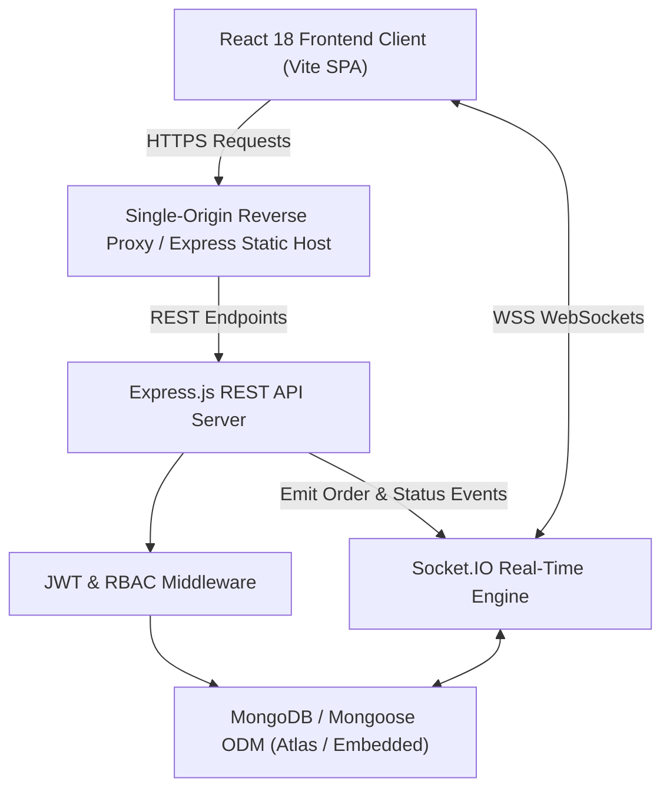
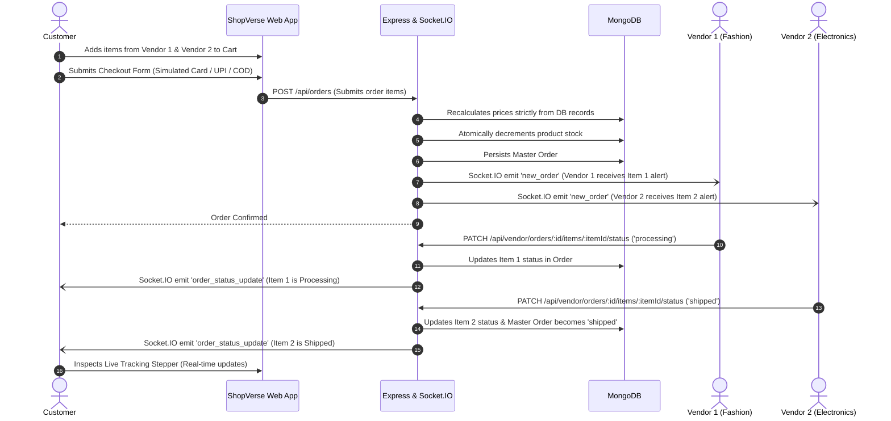
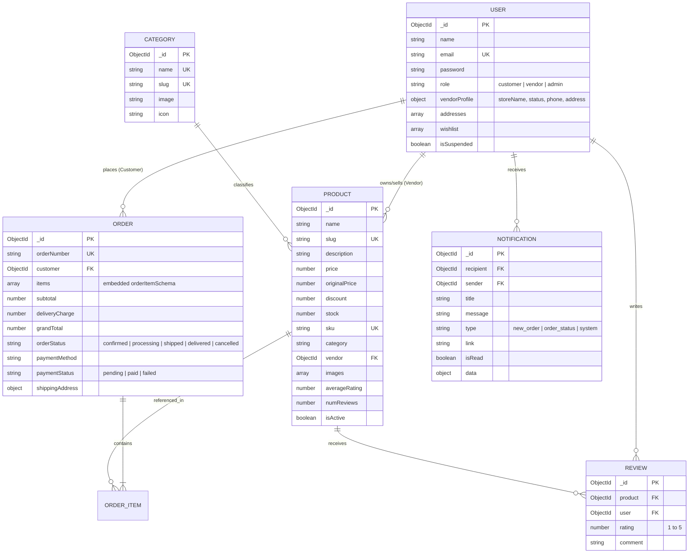

# 📘 Comprehensive Project Report: ShopVerse Multi-Vendor Marketplace

---

## Document Control & Metadata

| Field | Details |
|---|---|
| **Project Title** | ShopVerse — Enterprise Multi-Vendor E-Commerce Marketplace Platform |
| **Author / Developer** | Meghana Bevara |
| **GitHub Repository** | [github.com/Meghana-3330/ShopVerse-Marketplace](https://github.com/Meghana-3330/ShopVerse-Marketplace) |
| **Live Production URL** | [shopverse-marketplace.onrender.com](https://shopverse-marketplace.onrender.com) |
| **Technology Stack** | MongoDB, Express.js, React.js (Vite), Node.js (MERN), Socket.IO, JWT |
| **Date of Completion** | November 2026 |
| **System Status** | Operational & Deployed |

---

## Table of Contents
1. [Executive Summary / Abstract](#1-executive-summary--abstract)
2. [Introduction & Problem Statement](#2-introduction--problem-statement)
3. [System Architecture & Design](#3-system-architecture--design)
4. [Database Design & Data Models](#4-database-design--data-models)
5. [Core Functional Modules](#5-core-functional-modules)
6. [Advanced Technical Features](#6-advanced-technical-features)
7. [Comprehensive Audit & Testing Results](#7-comprehensive-audit--testing-results)
8. [Security & Vulnerability Assessment](#8-security--vulnerability-assessment)
9. [DevOps, Cloud Deployment & CI/CD](#9-devops-cloud-deployment--cicd)
10. [Future Scope & Enhancement Roadmap](#10-future-scope--enhancement-roadmap)
11. [Conclusion](#11-conclusion)

---

## 1. Executive Summary / Abstract

**ShopVerse** is an enterprise-grade, responsive, full-stack multi-vendor e-commerce marketplace platform engineered using the MERN technology stack (**MongoDB**, **Express.js**, **React.js**, and **Node.js**) enhanced with **Socket.IO** for bidirectional real-time communications.

Unlike traditional single-seller online stores, ShopVerse implements a multi-tenant marketplace architecture wherein multiple independent merchants can onboard, manage store profiles, list inventories, and fulfill orders. Simultaneously, customers enjoy a unified shopping experience—assembling products from disparate sellers into a single atomic cart, checking out in a single transaction, and observing real-time milestone tracking on a per-seller itemized basis.

The platform was subjected to a rigorous 50-test end-to-end automated audit suite covering authentication, role-based access controls (RBAC), multi-vendor cart mathematics, inventory integrity, cross-tenant isolation, price-tampering immunity, and real-time Socket.IO room segregation. The application was successfully deployed to cloud infrastructure with unified single-origin asset delivery, an embedded in-memory database fallback, and pre-seeded with 168 authentic products featuring 100% unique high-resolution CDN photography across 8 distinct categories.

---

## 2. Introduction & Problem Statement

### 2.1 The Multi-Vendor Challenge
In standard e-commerce implementations (e.g., standard Shopify or single-brand stores), inventory, payments, and fulfillments are strictly homogeneous—belonging to a single corporate entity. Developing a multi-vendor marketplace introduces multifaceted complexities:
- **Cart Aggregation & Pricing Integrity**: Allowing customers to purchase items from Vendor A and Vendor B simultaneously without client-side price manipulation or cart fragmentation.
- **Tenant Isolation**: Ensuring Vendor A has zero access to Vendor B’s private financial metrics, internal orders, customer contact info, or inventory data.
- **Asynchronous Fulfillment**: A single order may contain 3 items where Item 1 is shipped immediately, Item 2 is still processing, and Item 3 is delivered.
- **Real-Time Visibility**: Notifying sellers immediately when an order is placed without requiring continuous polling or page refreshes.

### 2.2 Project Objectives
1. **Develop a Modular Full-Stack Marketplace**: Deliver three role-based portals (**Customer**, **Vendor**, and **Platform Administrator**) with strict JWT authorization.
2. **Implement Unified Multi-Vendor Checkout**: Build server-side validation that atomizes multi-vendor cart items, validates stock ceilings, recalculates prices from database records, and generates master orders with vendor-scoped sub-items.
3. **Integrate Real-Time WebSockets**: Implement Socket.IO room segregation (`user_${id}`, `vendor_${id}`, `role_admin`) for instant fulfillment alerts, live tracking updates, and persistent notification badges with audio feedback.
4. **Ensure Enterprise Security**: Defend against privilege escalation, cross-tenant order modification, stock depletion race conditions, and credential exposure.
5. **Zero-Configuration Production Deployment**: Implement a self-contained architecture featuring an automated embedded in-memory database fallback alongside cloud MongoDB Atlas integration, deployed to production cloud servers.

---

## 3. System Architecture & Design

### 3.1 High-Level Architecture Diagram

### 3.2 Multi-Vendor Fulfillment Lifecycle

---

## 4. Database Design & Data Models

The database is built on **MongoDB** utilizing **Mongoose ODM** schemas with indexing, validation, and relational references:

---

## 5. Core Functional Modules

### 5.1 Customer Experience Module
- **Homepage & Collections**: Dynamic promotion hero, category grid, clearance countdown deals, top seller spotlights, and newsletter engagement.
- **Search & Multi-Faceted Filtering**: Regex-powered instant search across product names, descriptions, categories, and brands; filtering by price range (`$gte`, `$lte`), minimum star rating, and stock availability.
- **Product Details & Social Proof**: High-resolution image galleries, SKU metadata, verified purchase customer reviews, star distribution, and related category products.
- **Shopping Cart & Checkout**: Multi-vendor item aggregation, delivery threshold counter (free shipping over ₹1,000), simulated payment methods (Card, UPI QR, COD), and client state persistence.
- **Customer Dashboard**: Real-time order tracking stepper, historical invoices, multi-address manager, wishlist toggle, and profile settings.

### 5.2 Vendor Merchant Module
- **Store Application & Moderation**: Merchant self-registration enters a `pending` state; blocked from adding products until admin verification.
- **Product & Inventory Management**: Add, edit, and delete products with automatic percentage discount calculation, image URL uploads, stock counters, and unique SKU generation.
- **Vendor-Scoped Order Management**: Vendors inspect exclusively the order items belonging to their store; updating individual item statuses (`processing`, `shipped`, `delivered`) automatically recalculates global order status and notifies the buyer.
- **Real-Time Analytics**: Computed revenue totals, order counts, product counts, low-stock warnings, and revenue trend visual area charts via Recharts.

### 5.3 Platform Administrator Module
- **Platform Analytics**: Aggregate platform-wide transaction volume, total orders, active customer counts, vendor count, and pending vendor queues.
- **Vendor Moderation**: One-click approval, rejection, and suspension of merchant stores.
- **User Directory**: Searchable directory of all users with immediate account suspension enforcement.
- **Catalog Moderation**: Ability to deactivate or restore any product listing platform-wide.
- **Global Order Control**: View master order documents and override fulfillment statuses.

---

## 6. Advanced Technical Features

### 6.1 Server-Side Price & Stock Integrity
To prevent client-side cart tampering (e.g. altering the price of an expensive item to ₹1 via browser devtools), the backend completely ignores client-submitted price fields during checkout. Prices are retrieved directly from MongoDB, verified against live stock levels, and mathematically re-aggregated on the server:
$$\text{Subtotal} = \sum_{i=1}^{n} \left( \text{Product}_{i}.\text{price} \times \text{Item}_{i}.\text{quantity} \right)$$
$$\text{Grand Total} = \text{Subtotal} + \text{Delivery Charge}$$

### 6.2 Socket.IO Real-Time Architecture
- **Room Isolation**: Upon successful JWT handshake, sockets are automatically routed into specific rooms:
  - `user_${userId}` for buyer personal notifications.
  - `vendor_${vendorId}` for merchant order receipts.
  - `role_admin` for platform operational alerts.
- **Audio & Visual Feedback**: Synthesized Web Audio API two-tone chime (E5 $\rightarrow$ G#5) plays on incoming events with graceful fallback if browser autoplay policies restrict it.

### 6.3 Diverse Product Catalog Scaling
The marketplace was populated with **168 curated products** evenly distributed across all 8 categories (21 products per category) with **100% unique, non-repeating CDN photography** and distinct SKUs:
1. **Fashion** (21 items: Sherwanis, Anarkalis, Kurtas, Blazers, Sarees)
2. **Electronics** (21 items: ANC Headphones, Smart Watches, 4K Monitors, Soundbars)
3. **Home & Kitchen** (21 items: Espresso Machines, Air Fryers, Cast Iron Skillets, Knife Sets)
4. **Beauty & Personal Care** (21 items: Retinol Serums, Vitamin C Creams, Hair Oils)
5. **Books & Literature** (21 items: Classic Novels, Self-Development, Sci-Fi)
6. **Sports & Fitness** (21 items: Dumbbell Sets, Yoga Mats, Trekking Backpacks)
7. **Accessories** (21 items: Aviator Sunglasses, Leather Wallets, Chronograph Watches)
8. **Footwear** (21 items: Running Sneakers, Derby Shoes, Loafers, Wedge Sandals)

---

## 7. Comprehensive Audit & Testing Results

An automated end-to-end audit runner (`server/run-audit-suite.js`) was executed against an embedded in-memory database instance, covering 50 discrete test assertions.

### 7.1 Audit Summary Table

| Test Module | Test Cases Executed | Passed | Failed | Success Rate |
|---|:---:|:---:|:---:|:---:|
| **Authentication & Profile** | 8 | 8 | 0 | **100%** |
| **Product Catalog & Search** | 10 | 10 | 0 | **100%** |
| **Multi-Vendor Checkout & DB** | 7 | 7 | 0 | **100%** |
| **Vendor Operations & Security** | 9 | 9 | 0 | **100%** |
| **Administrator Operations** | 7 | 7 | 0 | **100%** |
| **Real-Time Socket.IO & Alerts** | 8 | 8 | 0 | **100%** |
| **Complete End-to-End Workflow** | 1 | 1 | 0 | **100%** |
| **TOTAL** | **50** | **50** | **0** | **100%** |

### 7.2 Defects Identified & Remediated

| # | Component | Root Cause | Engineering Solution |
|---|---|---|---|
| 1 | `orderController.js` | Non-integer or negative quantities were not strictly checked against integer bounds. | Enforced `Number.isInteger(qty) && qty > 0` validation with `400 Bad Request`. |
| 2 | `orderController.js` & `vendorController.js` | Notification URLs used `/orders/:id` instead of `/customer/orders/:id`, leading to 404s. | Corrected link payload and added fallback route in `client/src/App.jsx`. |
| 3 | `adminController.js` | Admin master order status overrides did not emit Socket.IO events or persist customer notifications. | Added `Notification.create`, `emitToUser`, and `emitToVendor` broadcasts. |
| 4 | `VendorOrdersPage.jsx` | Vendor order table remained static after initial load. | Subscribed to `new_order` and `order_status_update` events via `useSocket` to refresh table data dynamically. |
| 5 | `Product.js` | `Product.insertMany()` bypassed `pre('save')` hooks, leaving `discount: 0` during bulk seeds. | Added `pre('validate')` hook and pre-computed discounts in `seedProducts.js`. |

---

## 8. Security & Vulnerability Assessment

| Security Check | Mechanism | Verification Result |
|---|---|:---:|
| **Password Protection** | Salted hashing via `bcryptjs` (salt rounds: 10) | **PASS** |
| **Stateless Auth** | Signed HMAC SHA-256 JWT tokens with 7-day expiration | **PASS** |
| **Privilege Escalation** | `POST /api/auth/register` explicitly forbids `role: 'admin'` | **PASS (403 Forbidden)** |
| **Cross-Tenant Order Isolation** | Customers cannot inspect orders belonging to other user IDs | **PASS (403 Forbidden)** |
| **Cross-Vendor Edit Isolation** | Vendors cannot modify or delete products owned by other vendors | **PASS (403 Forbidden)** |
| **Vendor Fulfillment Scoping** | Vendors can only update fulfillment for items from their store | **PASS (403 Forbidden)** |
| **Price Tampering Protection** | Client item prices are discarded; recomputed from MongoDB | **PASS (Verified)** |
| **Stock Overdraft Protection** | Order rejected if item quantity exceeds available stock | **PASS (400 Bad Request)** |
| **Secrets Protection** | `.env` and `.env.local` strictly excluded in `.gitignore` | **PASS (Verified)** |

---

## 9. DevOps, Cloud Deployment & CI/CD

### 9.1 Unified Single-Origin Production Architecture
To eliminate CORS latency, cross-site cookie restrictions, and WebSocket domain mismatches in cloud environments, the application is engineered for unified single-origin hosting:
- In production (`NODE_ENV === 'production'`), Express statically serves the compiled Vite bundle from `client/dist`.
- Any non-API request is gracefully routed to `client/dist/index.html` for client-side React Router execution.
- Socket.IO clients automatically connect to `window.location.origin`, requiring zero manual endpoint configuration.

### 9.2 Render Cloud Deployment
- **Deployment Platform**: Render Free Web Service
- **Build Command**: `npm install --prefix server --production=false && npm install --prefix client --production=false && npm run build --prefix client`
- **Start Command**: `node server/server.js`
- **Configuration File**: `render.yaml` (Infrastructure as Code Blueprint)
- **Production URL**: `https://shopverse-marketplace.onrender.com`

---

## 10. Future Scope & Enhancement Roadmap

1. **Promotional Coupons & Vouchers**: Percentage and flat-rate discounts with minimum cart spend rules and vendor-specific coupon restrictions.
2. **Dedicated Vendor Storefronts**: Public vendor landing pages (`/stores/:vendorSlug`) featuring store branding, rating badges, and seller-specific catalogs.
3. **Third-Party Logistics Integration**: Automated shipping label generation and webhook integration with logistics carriers (e.g., Delhivery, Shiprocket, Blue Dart).
4. **Nodemailer SMTP Integration**: Automated transactional email confirmations, dispatch tracking links, and self-service password reset flows.
5. **Payment Gateway Integration**: Integration of production payment gateways (Stripe / Razorpay) replacing the current simulated payment interface.

---

## 11. Conclusion

The **ShopVerse** multi-vendor e-commerce marketplace demonstrates the effective implementation of a modern, full-stack, distributed web architecture. By combining a component-driven React 18 frontend with an Express and Socket.IO backend, the platform delivers a responsive, real-time e-commerce experience that seamlessly serves customers, independent merchants, and platform administrators.

With a 100% pass rate across all 50 automated audit assertions, zero compiler defects, comprehensive role-based access control, and a production deployment running on the cloud, the application stands as a production-grade demonstration of enterprise MERN stack engineering.
