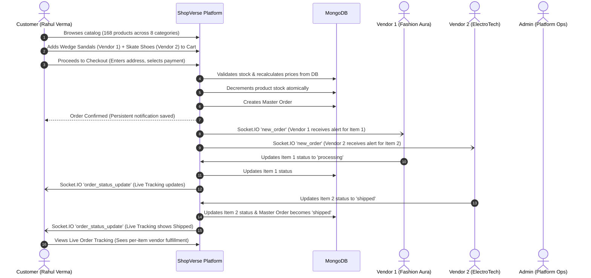

# 🛒 ShopVerse — Multi-Vendor E-Commerce Marketplace

<p align="center">
  
</p>

<p align="center">
  <strong>A modern, enterprise-grade, real-time Multi-Vendor E-Commerce platform built on the MERN stack.</strong>
</p>

<p align="center">
  
  
  
  
  
  
  
  
</p>

---

## 📖 Overview

**ShopVerse** is a production-grade multi-vendor e-commerce marketplace that bridges independent merchants and customers under a single, unified digital shopping ecosystem. 

Customers can discover 168+ unique curated products across 8 categories, assemble a single shopping cart featuring items from multiple independent vendors, and checkout in a single atomic transaction. Behind the scenes, the platform isolates fulfillment for each seller, updates order item statuses in real-time via Socket.IO, recalculates prices strictly on the server to prevent tampering, and provides platform administrators with real-time analytics.

---

## 🌟 Key Capabilities

### 🏬 True Multi-Vendor Architecture
- **Unified Multi-Vendor Cart**: Customers can place items from multiple independent sellers into a single shopping cart.
- **Server-Side Pricing & Stock Recalculation**: Prices and inventory quantities submitted by the client are strictly ignored and verified against MongoDB during checkout to guarantee price integrity.
- **Atomic Multi-Vendor Orders**: At checkout, a master order is generated with each item bound directly to its respective seller (`vendorId`).
- **Vendor-Isolated Order Management**: Sellers can inspect only items that belong to their store and advance fulfillment: `pending` ➔ `confirmed` ➔ `processing` ➔ `shipped` ➔ `delivered`.
- **Omniscient Administrator Control**: Platform administrators maintain overarching visibility across all vendors, products, users, and order statuses.

### ⚡ Real-Time Socket.IO Engine
- **Instant Order Notifications**: Sellers receive audio and toast notifications the instant a customer places an order containing their items.
- **Live Order Tracking**: As sellers update fulfillment (`processing` ➔ `shipped`), customer tracking views dynamically update without page refreshes.
- **Role-Based Rooms**: Automated Socket.IO room segregation (`user_${id}`, `vendor_${id}`, `role_admin`).
- **Persistent Notification Center**: Notifications persist to MongoDB with unread badge counters, mark-as-read, and mark-all-as-read actions.

### 🛍️ Rich Customer Experience
- **Expansive Catalog**: 168 products across 8 categories (Fashion, Electronics, Home & Kitchen, Beauty, Books, Sports, Accessories, Footwear) with 100% unique, non-repeating photos.
- **Advanced Filtering & Search**: Multi-faceted filter by category, price bounds, rating, stock availability, and sorting (price low-high, high-low, newest).
- **Interactive Details**: Multi-image preview, SKU tracking, verified customer reviews, instant "Buy Now" flow, and wishlist toggle.
- **Customer Dashboard**: Track shipments, manage multiple shipping addresses, view past invoices, and manage profile information.

### 🏢 Vendor Portal
- **Vendor Onboarding**: Merchants register their store and are held in a pending state until reviewed by administrators.
- **Storefront & Inventory**: Full CRUD operations for products with automatic SKU generation, stock decrementing, and pricing.
- **Real-Time Analytics**: Live calculation of total store revenue, orders received, low-stock warnings, and revenue trend charts via Recharts.

### 🛡️ Administrator Operations
- **Moderation Workflow**: Review pending vendor applications with one-click **Approve**, **Reject**, or **Suspend**.
- **User & Merchant Directory**: View and toggle account suspension across all customer and vendor accounts.
- **Catalog Moderation**: Deactivate inappropriate listings across the marketplace.
- **Global Order Control**: View all master orders and override order status when required.

---

## 🔄 End-to-End Multi-Vendor Workflow



---

## 🛠️ Technology Stack

| Layer | Technologies |
|---|---|
| **Frontend** | React 18, Vite 5, React Router DOM v6, Axios, Lucide React icons, Recharts |
| **Backend** | Node.js, Express 4, JWT (`jsonwebtoken`), `bcryptjs`, Morgan, CORS, express-rate-limit |
| **Real-Time** | Socket.IO v4 (WebSockets with polling fallback, room segregation) |
| **Database** | MongoDB & Mongoose 8 (includes embedded `MongoMemoryServer` fallback for instant zero-config startup) |
| **Design** | Mobile-first CSS3 design system with CSS custom properties (variables) |

---

## 📂 Project Architecture

```
ShopVerse/
├── client/                      # React + Vite Frontend
│   ├── src/
│   │   ├── components/
│   │   │   ├── common/          # Navbar, Footer, ProductCard, QuickViewModal, ProtectedRoute
│   │   │   ├── home/            # HeroBanner, CategorySection, SpecialOffersBanner, VendorHighlights
│   │   │   └── dashboard/       # AdminSidebar, VendorSidebar, CustomerSidebar
│   │   ├── pages/
│   │   │   ├── public/          # Home, Products, Product Details, Categories, Login, Register
│   │   │   ├── customer/        # Dashboard, Cart, Checkout, My Orders, Order Details, Wishlist
│   │   │   ├── vendor/          # Vendor Dashboard, Add/Edit Product, Manage Inventory, Vendor Orders
│   │   │   └── admin/           # Admin Dashboard, Manage Users, Manage Vendors, Manage Catalog, Manage Orders
│   │   ├── context/             # AuthContext, CartContext, SocketContext
│   │   ├── services/            # Axios API clients (auth, product, order, vendor, admin)
│   │   ├── App.jsx              # Main router & layout routes
│   │   └── main.jsx             # React DOM root
│   ├── vite.config.js           # Vite dev configuration & API proxy
│   └── package.json
│
├── server/                      # Node.js + Express REST API
│   ├── config/
│   │   └── db.js                # MongoDB connection with embedded memory engine fallback
│   ├── controllers/             # Auth, Product, Order, Vendor, Admin, Notification controllers
│   ├── middleware/              # JWT auth guard, RBAC middleware, error handler, rate limiter
│   ├── models/                  # User, Product, Order, Category, Review, Notification schemas
│   ├── routes/                  # Express REST route endpoints
│   ├── socket.js                # Socket.IO room manager and emitter utility
│   ├── utils/
│   │   ├── seedData.js          # Master database seeder
│   │   └── seedProducts.js      # 168 pre-computed products with unique CDN images
│   ├── run-audit-suite.js       # Standalone automated 50-test end-to-end audit runner
│   ├── server.js                # Express app entry point
│   └── package.json
│
├── .gitignore                   # Excludes .env, build output, and node_modules
└── README.md
```

---

## ⚡ Quick Start & Installation

### Prerequisites
- [Node.js](https://nodejs.org/) (v18 or newer recommended, v20+ supported)
- npm or pnpm
- MongoDB (optional — if no local MongoDB daemon is running, the server automatically starts an embedded in-memory database and pre-seeds it!)

---

### 1. Clone the Repository
```bash
git clone https://github.com/Meghana-3330/ShopVerse-Marketplace.git
cd ShopVerse-Marketplace
```

---

### 2. Backend Setup
```bash
cd server

# Install dependencies
npm install

# Start the backend server (starts on http://localhost:5000)
npm run dev
# or: npm start
```

---

### 3. Frontend Setup
In a new terminal window:
```bash
cd client

# Install dependencies
npm install

# Start the Vite development server (starts on http://localhost:5173)
npm run dev
```

Open your browser and navigate to: **`http://localhost:5173`**

---

## 🔑 Demo Logins for Evaluation

Use any demo account directly on the **Login Page** or enter these credentials:

| Role | Email | Password | Access Details |
|---|---|---|---|
| **Administrator** | `admin@marketplace.com` | `admin123` | Full admin control, vendor moderation, platform statistics |
| **Vendor 1 (Approved)** | `vendor1@marketplace.com` | `vendor123` | Store: *Fashion Aura & Apparels* (Ethnic wear, Footwear) |
| **Vendor 2 (Approved)** | `vendor2@marketplace.com` | `vendor123` | Store: *ElectroTech Gadgets* (Smart devices, Headphones) |
| **Vendor 3 (Approved)** | `vendor3@marketplace.com` | `vendor123` | Store: *Luxe Home & Living* (Kitchen appliances, Decor) |
| **Vendor 4 (Pending)** | `pending@marketplace.com` | `vendor123` | Store: *Organic Oasis Ayurveda* (Pending approval demo) |
| **Customer** | `customer@marketplace.com` | `customer123` | Active customer with saved addresses and order history |

> [!WARNING]
> Demo passwords (`admin123`, `vendor123`, `customer123`) are provided strictly for local development and academic evaluation. Enforce strong secrets and passwords prior to any production deployment.

---

## 🧪 Running the End-to-End Test Suite

An automated audit runner validates all 50 features across authentication, product catalog, vendor isolation, admin RBAC, Socket.IO rooms, and multi-vendor checkout:

```bash
cd server
node run-audit-suite.js
```

```text
================================================================
                     FINAL AUDIT SUMMARY                        
================================================================
Total Features Tested: 50
PASSED: 50
FAILED: 0
PARTIALLY WORKING: 0
================================================================
```

---

## 📡 Key API Routes

| Endpoint | Method | Access | Purpose |
|---|---|---|---|
| `/api/auth/register` | `POST` | Public | Register customer or vendor account |
| `/api/auth/login` | `POST` | Public | Authenticate user & issue signed JWT |
| `/api/products` | `GET` | Public | Filter, search, and paginate marketplace catalog |
| `/api/products/:id` | `GET` | Public | Retrieve single product details & verified reviews |
| `/api/orders` | `POST` | Customer | Atomically create multi-vendor order with server price validation |
| `/api/orders/my-orders` | `GET` | Customer | Retrieve customer's personal order history |
| `/api/vendor/dashboard` | `GET` | Vendor | Retrieve vendor sales analytics & revenue charts |
| `/api/vendor/orders` | `GET` | Vendor | Fetch vendor-isolated order items |
| `/api/vendor/orders/:oId/items/:iId/status` | `PATCH` | Vendor | Advance fulfillment status (`processing`, `shipped`, `delivered`) |
| `/api/admin/dashboard` | `GET` | Admin | Global marketplace analytics & revenue totals |
| `/api/admin/vendors/:id/status` | `PATCH` | Admin | Approve or reject vendor merchant applications |
| `/api/admin/users/:id/suspend` | `PATCH` | Admin | Suspend or reactivate user accounts |
| `/api/notifications` | `GET` | Private | Retrieve authenticated user's persistent notifications |

---

## 🔒 Security Best Practices

- **Strict Server-Side Price Calculation**: Client-sent prices are discarded; prices are recalculated directly from the database.
- **Privilege Escalation Protection**: Public registration rejects any request specifying `role: 'admin'`.
- **Tenant Isolation**: Sellers cannot inspect other sellers' orders or modify products they do not own.
- **Stock Depletion Guards**: Stock is validated at checkout; orders requesting excess or negative quantities are rejected.
- **Protected Secrets**: Sensitive environment configurations are excluded via `.gitignore`.

---

## 📄 License

This project is licensed under the [MIT License](LICENSE).
